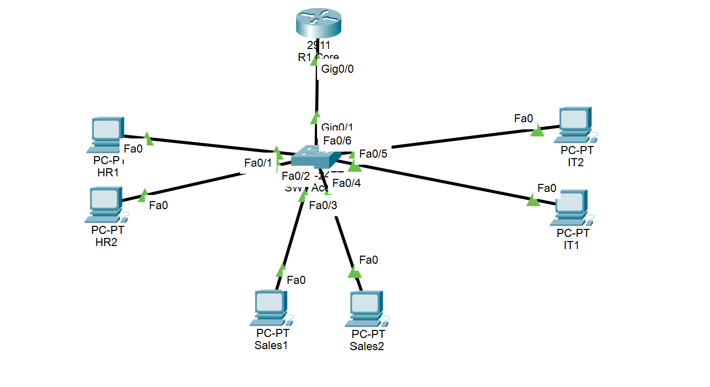

# Enterprise Multi-Department Network with VLANs & Router-on-a-Stick (ROAS)

## Overview
This repository contains a production-ready network topology designed in **Cisco Packet Tracer**. The project demonstrates network segmentation, Layer 2 trunking, 802.1Q encapsulation, Router-on-a-Stick (ROAS) inter-VLAN routing, and centralized Cisco IOS DHCP service.

---

## Key Features & Technologies
* **Network Segmentation:** VLAN 10 (HR), VLAN 20 (Sales), VLAN 30 (IT).
* **Trunking Protocol:** IEEE 802.1Q trunking on switch interface `Gi0/1`.
* **Inter-VLAN Routing:** Router-on-a-Stick using logical sub-interfaces on `R1-Core`.
* **Automated IP Management:** Cisco IOS DHCP pools for each department subnet with IP exclusions for gateways.

---

## Network Addressing & Topology Scheme

| Device Name | Interface | Assigned IP / Gateway | Subnet Mask | VLAN ID & Name |
| :--- | :--- | :--- | :--- | :--- |
| **R1-Core** | `Gi0/0.10` | 192.168.10.1 | 255.255.255.0 | VLAN 10 (HR Gateway) |
| **R1-Core** | `Gi0/0.20` | 192.168.20.1 | 255.255.255.0 | VLAN 20 (Sales Gateway) |
| **R1-Core** | `Gi0/0.30` | 192.168.30.1 | 255.255.255.0 | VLAN 30 (IT Gateway) |
| **SW1-Access** | `Gi0/1` | Trunk Link | N/A | VLAN 10, 20, 30 |
| **PC-HR1 / HR2** | `Fa0/1 - 2` | DHCP Scope (`192.168.10.0/24`) | 255.255.255.0 | VLAN 10 (HR) |
| **PC-Sales1 / 2** | `Fa0/3 - 4` | DHCP Scope (`192.168.20.0/24`) | 255.255.255.0 | VLAN 20 (Sales) |
| **PC-IT1 / IT2** | `Fa0/5 - 6` | DHCP Scope (`192.168.30.0/24`) | 255.255.255.0 | VLAN 30 (IT) |

---

## Network Architecture Diagram


---

## Implementation & CLI Configurations

### 1. Switch Configuration (`SW1-Access`)
```text
enable
configure terminal
hostname SW1-Access

! Create VLANs
vlan 10
 name HR
vlan 20
 name Sales
vlan 30
 name IT

! Access Port Assignments
interface range FastEthernet 0/1 - 2
 switchport mode access
 switchport access vlan 10

interface range FastEthernet 0/3 - 4
 switchport mode access
 switchport access vlan 20

interface range FastEthernet 0/5 - 6
 switchport mode access
 switchport access vlan 30

! Trunk Link Configuration
interface GigabitEthernet 0/1
 switchport mode trunk
 description Uplink-To-R1
